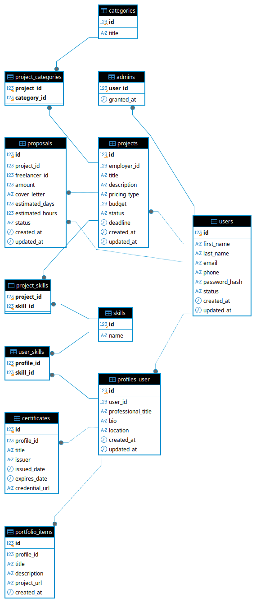

# Marketplace Freelance — فاز طراحی پایگاه داده

آزمایشگاه مهندسی نرم‌افزار — تمرین ۲ (طراحی و پیاده‌سازی پایگاه داده)

## ۱. معرفی پروژه

Marketplace Freelance یک وب‌اپلیکیشن فریلنسری است. کاربران حساب می‌سازند و پروفایل خود را کامل می‌کنند؛ **کارفرما** پروژه (با توضیحات، بودجه، دسته‌بندی و مهارت‌های موردنیاز) ثبت می‌کند؛ **فریلنسر** پروژه‌های باز را می‌بیند و **پیشنهاد** می‌فرستد؛ کارفرما پیشنهادها را بررسی می‌کند و برای هر پروژه **حداکثر یک** پیشنهاد را می‌پذیرد.

در این مرحله فقط **پایگاه داده** طراحی و پیاده‌سازی شده است (بدون بک‌اند و فرانت‌اند).

<<<<<<< Updated upstream

## لینک‌ها
- Jira: https://shydaskry6.atlassian.net/jira/software/projects/FM/boards/3?sprintStarted=true&filter=&groupBy=none
- مستندات نیازمندی‌ها: [docs/requirements.md](docs/requirements.md)
- بک‌لاگ: [docs/jira-backlog.md](docs/jira-backlog.md)
=======
| مورد | مقدار |
|---|---|
| DBMS | PostgreSQL |
| نسخه | ۱۴ یا بالاتر (ستون‌های IDENTITY، ایندکس یکتای جزئی، ایندکس روی عبارت، تریگرهای PL/pgSQL) |
| نام دیتابیس | `lab_freelance` |
| انکودینگ | UTF-8 (برای داده‌های فارسی) |

## ۲. ساختار مخزن

```
freelance-marketplace/
├── README.md
├── database/
│   ├── schema.sql      # ساخت نوع‌ها، جدول‌ها، قیدها، ایندکس‌ها و تریگرها
│   ├── seed.sql        # داده نمونه
│   ├── queries.sql     # Queryهای کاربردی
│   └── tests.sql       # سناریوهای آزمون قیدها و قواعد کسب‌وکار
└── docs/
    ├── erd.png         # نمودار ERD
    ├── erd.dot         # سورس نمودار (Graphviz)
    └── jira-github-plan.md
```

## ۳. نحوه ایجاد دیتابیس و اجرای فایل‌ها

```bash
# 1) ساخت دیتابیس (یک بار)
createdb -U postgres -E UTF8 lab_freelance
#   یا داخل psql:  CREATE DATABASE lab_freelance ENCODING 'UTF8';

# 2) ساخت ساختار (جدول‌ها، قیدها، تریگرها)
psql -U postgres -d lab_freelance -v ON_ERROR_STOP=1 -f database/schema.sql

# 3) وارد کردن داده نمونه
psql -U postgres -d lab_freelance -v ON_ERROR_STOP=1 -f database/seed.sql

# 4) اجرای Queryها
psql -U postgres -d lab_freelance -f database/queries.sql

# 5) اجرای آزمون‌ها (همه‌چیز در یک تراکنش اجرا و در پایان Rollback می‌شود؛ داده تغییر نمی‌کند)
psql -U postgres -d lab_freelance -f database/tests.sql
```

نکته‌ها:
- `schema.sql` قابل اجرای مجدد است (ابتدا اشیای خودش را حذف می‌کند)؛ بعد از اجرای دوباره باید `seed.sql` را هم دوباره اجرا کنید.
- `seed.sql` را روی دیتابیس خالی (بعد از `schema.sql`) اجرا کنید.
- در خروجی `tests.sql` ابتدا چند خط خالی (خروجی توابع کمکی) چاپ می‌شود؛ جدول نتایج (`PASS`/`FAIL`) و خلاصه در انتهای خروجی است.
- اگر ترمینال ویندوز فارسی را درست نشان نداد: `chcp 65001` و `SET client_encoding TO 'UTF8';`

## ۴. نمودار ERD



### جدول‌ها

| جدول | نقش |
|---|---|
| `users` | همه حساب‌ها (کاربران عادی و مدیران) |
| `admins` | حساب‌های دارای دسترسی مدیریتی + زمان اعطای دسترسی |
| `profiles_user` | اطلاعات تکمیلی کاربر عادی (حداکثر یکی برای هر کاربر) |
| `skills` | فهرست مهارت‌ها |
| `categories` | فهرست دسته‌بندی‌ها |
| `user_skills` | واسط: پروفایل ↔ مهارت (چند به چند) |
| `portfolio_items` | نمونه‌کارهای یک پروفایل (۱ به چند) |
| `certificates` | گواهی‌نامه‌های یک پروفایل (۱ به چند) |
| `projects` | پروژه‌های ثبت‌شده توسط کارفرما |
| `project_categories` | واسط: پروژه ↔ دسته‌بندی (چند به چند) |
| `project_skills` | واسط: پروژه ↔ مهارت موردنیاز (چند به چند) |
| `proposals` | پیشنهادهای فریلنسرها برای پروژه‌ها |

## ۵. تصمیم‌های طراحی و دلیل آن‌ها

### ۵.۱ مدل‌سازی کارفرما و فریلنسر
«کارفرما» و «فریلنسر» **نقش** هستند نه نوع کاربر: هر کاربر عادی هم پروژه ثبت می‌کند (`projects.employer_id`) و هم پیشنهاد می‌فرستد (`proposals.freelancer_id`)، پس هر دو به یک جدول `users` وصل‌اند. نیازی به جدول جدا برای هر نقش نیست و نام فریلنسر یا کارفرما در هیچ جدولی تکرار نمی‌شود.

### ۵.۲ مدل‌سازی مدیران (Admin)
مدیران با **جدول جدا `admins`** (کلید اصلی و خارجی: `user_id`، به‌اضافه `granted_at`) مدل شده‌اند، نه با ستون `role` در `users`.

دلایل:
- نیاز صریح تکلیف: «شناسایی حساب‌های مدیر» و «ثبت زمان اعطای دسترسی»؛ ستون `granted_at` فقط برای مدیرها معنا دارد و در `users` برای بیشتر ردیف‌ها `NULL` می‌شد.
- مدیر هنوز یک حساب در `users` است (ورود و رمز عبور یکسان) و فقط یک ردیف اضافه در `admins` دارد.
- افزودن/لغو دسترسی مدیریتی فقط با درج/حذف یک ردیف انجام می‌شود و جدول `users` تغییر نمی‌کند.
- اگر بعداً نقش‌های دیگری لازم شد، گسترش آن (مثلاً جدول `roles`) ساده است.

قاعده «مدیر نه پروژه می‌سازد نه پیشنهاد می‌فرستد» با تریگر اعمال می‌شود (چون به داده جدول دیگر نیاز دارد و `CHECK` ساده نمی‌تواند آن را بیان کند). مدیر پروفایل هم ندارد (پروفایل مخصوص کاربران عادی است). برعکس هم برقرار است: به حسابی که قبلاً پروژه، پیشنهاد یا پروفایل دارد نمی‌شود دسترسی مدیریتی داد، تا این قاعده همیشه برقرار بماند.

### ۵.۳ پروفایل و اطلاعات چندمقداری
- `profiles_user` با `UNIQUE (user_id)` رابطه یک‌به‌حداکثر‌یک با کاربر دارد.
- عنوان حرفه‌ای، معرفی و موقعیت مکانی اختیاری (`NULL`) هستند.
- مهارت‌ها، نمونه‌کارها و گواهی‌نامه‌ها در ستون‌های متنی (مثلاً لیست جداشده با کاما) ذخیره **نمی‌شوند**؛ چون چندمقداری‌اند، به جدول‌های جدا (`user_skills`، `portfolio_items`، `certificates`) رفته‌اند (رعایت 1NF).
- این جدول‌ها به **پروفایل** وصل‌اند، نه مستقیم به کاربر، چون مطابق تکلیف این اطلاعات بخشی از پروفایل کاربر عادی هستند.

### ۵.۴ روابط چند به چند با جدول واسط
`user_skills`، `project_skills` و `project_categories` با **کلید اصلی مرکب** (دو کلید خارجی) ساخته شده‌اند؛ بنابراین ثبت تکراری یک مهارت/دسته‌بندی برای یک پروفایل یا پروژه امکان‌پذیر نیست. روی ستون دوم هر کلید مرکب هم ایندکس گذاشته شده تا جست‌وجو و فیلتر بر اساس مهارت یا دسته‌بندی سریع باشد.

### ۵.۵ یکتایی نام‌ها و ایمیل
ایمیل، نام مهارت و عنوان دسته‌بندی با **ایندکس یکتا روی `lower(...)`** یکتا شده‌اند تا `Python` و `python` یا `Ali@x.com` و `ali@x.com` دو مقدار متفاوت حساب نشوند.

### ۵.۶ قیمت‌گذاری پروژه و مبلغ پیشنهاد
- `projects.pricing_type` فقط `fixed` یا `hourly` است (نوع ENUM).
- `projects.budget`: در پروژه ثابت = کل بودجه، در پروژه ساعتی = نرخ ساعتی. در `proposals.amount` هم همین معنا برقرار است. این‌طوری برای هر دو نوع فقط یک ستون داریم و معنای آن از نوع قیمت‌گذاری پروژه مشخص می‌شود (اطلاعات تکراری در دو ستون نمی‌ماند).
- `estimated_hours` (ساعت تخمینی) فقط برای پروژه‌های ساعتی مجاز است و `estimated_days` (مدت تخمینی به روز) برای هر دو نوع. هر دو اختیاری‌اند.
- بودجه، مبلغ/نرخ، ساعت و روز تخمینی با `CHECK > 0` مثبت اجباری شده‌اند.
- واحد پول در تکلیف مشخص نشده؛ مبالغ `NUMERIC(12,2)` و بدون ستون ارز ذخیره می‌شوند (فرض: ریال/تومان یک‌واحدی در کل پلتفرم).

### ۵.۷ پیشنهاد تکراری و «حداکثر یک پیشنهاد پذیرفته‌شده»
- `UNIQUE (project_id, freelancer_id)`: هر فریلنسر برای هر پروژه حداکثر یک پیشنهاد دارد (حتی اگر پیشنهادش پس‌گرفته شود، پیشنهاد دوم ثبت نمی‌شود؛ باید همان ردیف مدیریت شود).
- ایندکس **یکتای جزئی** `UNIQUE (project_id) WHERE status = 'accepted'`: در هر پروژه حداکثر یک پیشنهاد پذیرفته‌شده می‌تواند وجود داشته باشد. این قید حتی در شرایط هم‌زمانی (دو کارفرما/دو درخواست هم‌زمان) هم کار می‌کند و آخرین خط دفاع است؛ تریگرها فقط پیام خطای روشن‌تر و منطق جریان کار را اضافه می‌کنند.

### ۵.۸ قواعدی که با تریگر اعمال می‌شوند
قواعدی که به داده جدول دیگر وابسته‌اند با تریگر پیاده شده‌اند:

| قاعده | پیاده‌سازی |
|---|---|
| کاربر برای پروژه خودش پیشنهاد نمی‌دهد | `trg_proposals_validate` |
| پیشنهاد فقط برای پروژه `open` و فقط با وضعیت اولیه `pending` | `trg_proposals_validate` |
| مدیر نه پروژه می‌سازد نه پیشنهاد می‌دهد و پروفایل ندارد | `trg_projects_validate`، `trg_proposals_validate`، `trg_profiles_user_validate` |
| به حسابی که پروژه/پیشنهاد/پروفایل دارد نمی‌شود دسترسی مدیریتی داد | `trg_admins_validate` |
| پذیرش پیشنهاد → وضعیت پروژه `in_progress` می‌شود | `trg_proposals_after_accept` |
| بعد از پذیرش، پیشنهادهای pending دیگر همان پروژه `rejected` می‌شوند | `trg_proposals_after_accept` |
| لغو پروژه → پیشنهادهای pending آن `rejected` می‌شوند | `trg_projects_after_status_change` |
| ماشین وضعیت پروژه و پیشنهاد (بخش ۶) | `trg_projects_validate`، `trg_proposals_validate` |
| `updated_at` در هر UPDATE خودکار به‌روز می‌شود | `trg_*_set_updated_at` |
| فقط پروژه `draft` حذف فیزیکی می‌شود | `trg_projects_prevent_delete` |

### ۵.۹ سیاست حذف داده‌ها (بدون حذف آبشاری خطرناک)
- **کاربران:** همه کلیدهای خارجی به `users` (پروژه، پیشنهاد، مدیر) `ON DELETE RESTRICT` هستند. یعنی کاربری که سابقه دارد حذف نمی‌شود؛ برای غیرفعال‌کردن باید `status` را `inactive` یا `blocked` کرد.
- **پروژه‌ها:** حذف فیزیکی فقط برای `draft` مجاز است؛ پروژه‌های دیگر باید `cancelled` شوند. کلید خارجی `proposals → projects` هم `RESTRICT` است.
- **مهارت و دسته‌بندی:** تا وقتی در پروفایل یا پروژه‌ای استفاده می‌شوند، حذف‌شدنی نیستند (`RESTRICT`).
- **`CASCADE` فقط جایی است که داده، جزء جدایی‌ناپذیر مالک خودش است و سابقه کسب‌وکاری نیست:** پروفایل ← کاربر، و نمونه‌کار / گواهی‌نامه / مهارت‌های پروفایل ← پروفایل، و ردیف‌های واسط پروژه (دسته‌بندی و مهارت) ← پروژه. (کاربر هم فقط وقتی حذف می‌شود که هیچ پروژه، پیشنهاد یا دسترسی مدیریتی نداشته باشد.)

### ۵.۱۰ رمز عبور
فقط `password_hash` ذخیره می‌شود (نه رمز ساده). یک `CHECK` ساده طول هش را حداقل ۲۰ نویسه می‌خواهد تا رمز ساده کوتاه به‌اشتباه ذخیره نشود. این فقط یک سد ایمنی ساده است؛ هش‌کردن واقعی (مثلاً bcrypt یا argon2) باید در بک‌اند انجام شود. هش‌های `seed.sql` ساختگی هستند.

### ۵.۱۱ نوع‌های ENUM برای وضعیت‌ها
وضعیت حساب، نوع قیمت‌گذاری، وضعیت پروژه و وضعیت پیشنهاد با `CREATE TYPE ... AS ENUM` تعریف شده‌اند: مقدار نامعتبر پذیرفته نمی‌شود و ذخیره‌سازی کوچک است. اگر بعداً وضعیت جدیدی لازم شد، با `ALTER TYPE ... ADD VALUE` اضافه می‌شود (و قواعد انتقال آن باید در تریگر و این README به‌روز شود).

## ۶. وضعیت‌ها و قواعد تغییر وضعیت

### وضعیت حساب (`user_status`)
`active` (فعال) / `inactive` (غیرفعال) / `blocked` (مسدود). تغییر بین آن‌ها آزاد است؛ تصمیم درباره اینکه چه کسی و چه زمانی وضعیت را عوض کند با لایه برنامه (مدیر) است.

### وضعیت پروژه (`project_status`)

```
draft ──► open ──► in_progress ──► completed
  │         │            │
  └─────────┴────────────┴──────► cancelled
```

| وضعیت | معنا |
|---|---|
| `draft` | پیش‌نویس؛ هنوز پیشنهادی نمی‌گیرد |
| `open` | باز برای دریافت پیشنهاد |
| `in_progress` | یک پیشنهاد پذیرفته شده و کار در حال انجام است |
| `completed` | تکمیل‌شده (وضعیت نهایی) |
| `cancelled` | لغوشده (وضعیت نهایی) |

قواعد: وضعیت اولیه فقط `draft` یا `open`؛ انتقال‌های مجاز فقط همان‌هایی است که در نمودار آمده؛ رسیدن به `in_progress` فقط وقتی ممکن است که یک پیشنهاد `accepted` برای آن پروژه وجود داشته باشد (عملاً با پذیرش پیشنهاد خودکار انجام می‌شود)؛ `completed` و `cancelled` نهایی‌اند.

### وضعیت پیشنهاد (`proposal_status`)

```
pending ──► accepted
   ├──────► rejected
   └──────► withdrawn
```

| وضعیت | معنا |
|---|---|
| `pending` | ارسال‌شده و در انتظار بررسی کارفرما |
| `accepted` | پذیرفته‌شده توسط کارفرما (نهایی) |
| `rejected` | ردشده توسط کارفرما، یا خودکار بعد از پذیرش پیشنهاد دیگر / لغو پروژه (نهایی) |
| `withdrawn` | پیش از پذیرش به درخواست فریلنسر پس‌گرفته شده (نهایی) |

قواعد: فقط پیشنهاد `pending` می‌تواند تغییر وضعیت بدهد یا ویرایش شود؛ پیشنهاد جدید فقط به‌صورت `pending` و فقط برای پروژه `open` ثبت می‌شود؛ پذیرش فقط وقتی ممکن است که پروژه هنوز `open` باشد.

## ۷. داده نمونه

`seed.sql` شامل این موارد است (بیشتر از حداقل خواسته‌شده):

- **۵ حساب:** ۱ مدیر (`admin@marketplace.test`) و ۴ کاربر عادی؛ **علی رضایی** هم کارفرما (پروژه «تحلیل داده») و هم فریلنسر (پیشنهاد برای پروژه سارا) است.
- **۳ دسته‌بندی**، **۵ مهارت**، ۴ پروفایل (با فیلدهای اختیاری خالی در بعضی)، ۴ نمونه‌کار، ۲ گواهی‌نامه.
- **۳ پروژه:** فروشگاه اینترنتی (ثابت، سارا)، تحلیل داده (ساعتی، علی)، طراحی لوگو (ثابت، سارا؛ بدون پیشنهاد).
- **۴ پیشنهاد معتبر:** پیشنهاد نگار برای پروژه «تحلیل داده» پذیرفته می‌شود؛ تریگرها پروژه را `in_progress` و پیشنهاد رضا برای همان پروژه را `rejected` می‌کنند. دو پیشنهاد برای فروشگاه (علی و رضا) `pending` می‌مانند.

وضعیت نهایی داده‌ها:

| پروژه | وضعیت | پیشنهادها |
|---|---|---|
| توسعه وب‌سایت فروشگاه اینترنتی | `open` | علی (`pending`)، رضا (`pending`) |
| تحلیل داده‌های فروش و ساخت داشبورد | `in_progress` | نگار (`accepted`)، رضا (`rejected`) |
| طراحی لوگو و هویت بصری برند | `open` | — |

## ۸. Queryها (`database/queries.sql`)

| شماره | توضیح | نتیجه مورد انتظار روی داده نمونه |
|---|---|---|
| Q1 | پروژه‌های باز + دسته‌بندی‌ها + کارفرما | ۲ ردیف (فروشگاه، لوگو) |
| Q2 | پیشنهادهای یک پروژه + نام فریلنسر | ۲ ردیف برای پروژه «تحلیل داده»: نگار (`accepted`)، رضا (`rejected`) |
| Q3 / Q3-b | پروژه‌های هر کارفرما + تعداد پیشنهادها (به‌تفکیک پروژه / کل) | علی: ۱ پروژه با ۲ پیشنهاد؛ سارا: ۲ پروژه با ۲ و ۰ پیشنهاد |
| Q4 | مهارت‌های موردنیاز هر پروژه | ۳ ردیف (هر پروژه یک ردیف) |
| Q5–Q8 | اضافه: همه پیشنهادها با پروژه/کارفرما/فریلنسر؛ نقش دوگانه کاربر؛ تطبیق مهارت فریلنسر با پروژه‌های باز؛ فهرست مدیران | — |

## ۹. سناریوهای آزمون (`database/tests.sql`)

هر آزمون در `tests.sql` با کد `Txx` اجرا می‌شود و نتیجه `PASS`/`FAIL` را در جدول انتهای خروجی نشان می‌دهد. SQLSTATE: ‏`23505` تکراری، `23503` کلید خارجی، `23514` قید `CHECK` یا قاعده تریگر، `23502` مقدار `NULL` غیرمجاز، `22P02` مقدار نامعتبر enum.

«اعمال در» ستون آخر مشخص می‌کند قاعده در **پایگاه داده** اعمال می‌شود یا در **برنامه** (بک‌اند) باید هم بررسی شود.

### قیدهای اصلی خواسته‌شده در تکلیف

| کد | سناریو | نتیجه مورد انتظار | اعمال در |
|---|---|---|---|
| T01 | ثبت کاربر با ایمیل تکراری | رد؛ `23505` | DB — ایندکس یکتا روی `lower(email)` |
| T02 | ایمیل تکراری با حروف بزرگ/کوچک متفاوت | رد؛ `23505` | DB |
| T08 | پیشنهاد برای پروژه‌ای که وجود ندارد | رد؛ `23503` | DB — کلید خارجی |
| T09 | پیشنهاد از فریلنسری که وجود ندارد | رد؛ `23503` | DB — کلید خارجی |
| T10 | پروژه با کارفرمای ناموجود | رد؛ `23503` | DB — کلید خارجی |
| T12 | دومین پیشنهاد یک فریلنسر برای همان پروژه | رد؛ `23505` | DB — `UNIQUE (project_id, freelancer_id)` |
| T13 / T14 | بودجه پروژه صفر / منفی | رد؛ `23514` | DB — `CHECK (budget > 0)` |
| T15 | نرخ ساعتی پروژه صفر | رد؛ `23514` | DB |
| T16 / T17 | مبلغ یا نرخ پیشنهادی صفر / منفی | رد؛ `23514` | DB — `CHECK (amount > 0)` |
| T18 / T19 | ساعت یا روز تخمینی صفر | رد؛ `23514` | DB — `CHECK` |
| T30 | پذیرش پیشنهاد دوم در پروژه‌ای که یکی پذیرفته شده | رد؛ `23514` | DB — تریگر و ماشین وضعیت |
| T31 | همان سناریو وقتی تریگر غیرفعال است | رد؛ `23505` | DB — ایندکس یکتای جزئی (آخرین خط دفاع) |

### قواعد کسب‌وکار و یکپارچگی (اضافه)

| کد | سناریو | نتیجه مورد انتظار | اعمال در |
|---|---|---|---|
| T03 / T05 | ایمیل یا شماره موبایل با فرمت نامعتبر | رد؛ `23514` | DB — `CHECK` (اعتبارسنجی کامل‌تر در برنامه) |
| T04 | ذخیره رمز عبور ساده (کوتاه) | رد؛ `23514` | DB (سد ساده) + هش‌کردن در **برنامه** |
| T06 | نام خانوادگی `NULL` | رد؛ `23502` | DB — `NOT NULL` |
| T07 | وضعیت حساب نامعتبر (`banned`) | رد؛ `22P02` | DB — ENUM |
| T11 | مهارت ناموجود در `project_skills` | رد؛ `23503` | DB |
| T20 | ساعت تخمینی برای پروژه قیمت ثابت | رد؛ `23514` | DB — تریگر |
| T21 | پیشنهاد برای پروژه خودِ کاربر | رد؛ `23514` | DB — تریگر |
| T22 | پیشنهاد برای پروژه `in_progress` | رد؛ `23514` | DB — تریگر |
| T23 | پیشنهاد برای پروژه `draft` | رد؛ `23514` | DB — تریگر |
| T24 | درج پیشنهاد مستقیماً با وضعیت `accepted` | رد؛ `23514` | DB — تریگر |
| T25 / T26 / T27 | مدیر پیشنهاد می‌فرستد / پروژه می‌سازد / پروفایل می‌گیرد | رد؛ `23514` | DB — تریگر |
| T28 | اعطای دسترسی مدیریتی به حسابی که پروژه دارد | رد؛ `23514` | DB — تریگر |
| T29 | پروفایل دوم برای یک کاربر | رد؛ `23505` | DB — `UNIQUE (user_id)` |
| T32 | انتقال غیرمجاز پروژه `open → completed` | رد؛ `23514` | DB — تریگر |
| T33 | `in_progress` شدن پروژه بدون پیشنهاد پذیرفته‌شده | رد؛ `23514` | DB — تریگر |
| T34 | بازکردن دوباره پروژه `completed` | رد؛ `23514` | DB — تریگر |
| T35 | پس‌گرفتن پیشنهادِ پذیرفته‌شده | رد؛ `23514` | DB — تریگر |
| T36 | ویرایش مبلغ پیشنهادی که دیگر `pending` نیست | رد؛ `23514` | DB — تریگر |
| T37 / T38 | تغییر نوع قیمت‌گذاری بعد از دریافت پیشنهاد / تغییر کارفرما | رد؛ `23514` | DB — تریگر |
| T39 | حذف کاربری که پروژه/پیشنهاد دارد | رد؛ `23503` | DB — `ON DELETE RESTRICT` |
| T40 | حذف پروژه غیر `draft` | رد؛ `23514` | DB — تریگر |
| T41 / T42 | حذف مهارت / دسته‌بندی در حال استفاده | رد؛ `23503` | DB — `RESTRICT` |
| T43 / T44 | نام مهارت یا عنوان دسته‌بندی تکراری | رد؛ `23505` | DB — ایندکس یکتا |
| T45 | گواهی‌نامه‌ای که قبل از صدورش منقضی می‌شود | رد؛ `23514` | DB — `CHECK` |

### سناریوهای مثبت (عملیات معتبر باید موفق باشد)

| کد | سناریو | نتیجه مورد انتظار |
|---|---|---|
| S01 | پذیرش پیشنهاد | پروژه `in_progress` می‌شود و پیشنهاد pending دیگر `rejected` |
| S02 | لغو پروژه | همه پیشنهادهای pending آن `rejected` می‌شوند |
| S03 | پس‌گرفتن پیشنهاد `pending` | وضعیت `withdrawn` |
| S04 | پیشنهاد معتبر برای پروژه `open` | ثبت می‌شود |
| S05 | انتشار پیش‌نویس (`draft → open`) و ثبت پیشنهاد روی آن | موفق |
| S06 | `updated_at` بعد از UPDATE خودکار تازه می‌شود | موفق |
| S07 / S08 | داده نمونه: حداکثر یک پیشنهاد پذیرفته‌شده در هر پروژه؛ مدیران پروژه/پیشنهاد/پروفایل ندارند | موفق |

### آنچه در برنامه (بک‌اند) باید بررسی شود
پایگاه داده نمی‌داند «چه کسی» درخواست را می‌فرستد، پس این موارد در لایه برنامه باید اعمال شوند: فقط کارفرمای همان پروژه می‌تواند پیشنهاد را بپذیرد/رد کند؛ فقط خود فریلنسر می‌تواند پیشنهادش را پس بگیرد؛ فقط کاربر `active` می‌تواند پروژه/پیشنهاد ثبت کند؛ هش‌کردن واقعی رمز عبور؛ اعتبارسنجی دقیق‌تر ایمیل و موبایل؛ همچنین اینکه `deadline` (مهلت) تاریخ گذشته نباشد.

## ۱۰. مرور قیدها (چک‌لیست)

- کلید اصلی برای همه جدول‌ها (مرکب برای جدول‌های واسط) ✔
- کلید خارجی برای همه ارتباط‌ها، با سیاست حذف مشخص ✔
- `NOT NULL`، `UNIQUE`، `CHECK` و `DEFAULT` در جاهای لازم ✔
- روابط چند به چند با جدول واسط، بدون ذخیره تکراری اطلاعات (نام فریلنسر در `proposals` تکرار نشده) ✔
- بودجه/مبلغ/نرخ/ساعت/روز تخمینی مثبت ✔
- ایمیل تکراری، پیشنهاد تکراری و کلید خارجی نامعتبر پذیرفته نمی‌شود ✔
- کاربر برای پروژه خودش پیشنهاد نمی‌دهد؛ پیشنهاد فقط برای پروژه باز؛ حداکثر یک پیشنهاد پذیرفته‌شده و به‌روزرسانی وضعیت پروژه بعد از پذیرش ✔
- سیاست حذف بدون cascade خطرناک ✔
- رمز عبور به صورت متن ساده ذخیره نمی‌شود ✔
- مدیران نمی‌توانند پروژه ثبت کنند یا پیشنهاد بفرستند ✔

## ۱۱. Jira و GitHub

- مخزن GitHub: `https://github.com/Alma252/freelance-marketplace` *(لینک واقعی را اینجا بگذارید)*
- شواهد Jira (برد، تسک‌ها و وضعیت آن‌ها): *(https://shydaskry6.atlassian.net/jira/software/projects/FM/boards/3?sprintStarted=true&filter=&groupBy=none)*

>>>>>>> Stashed changes
